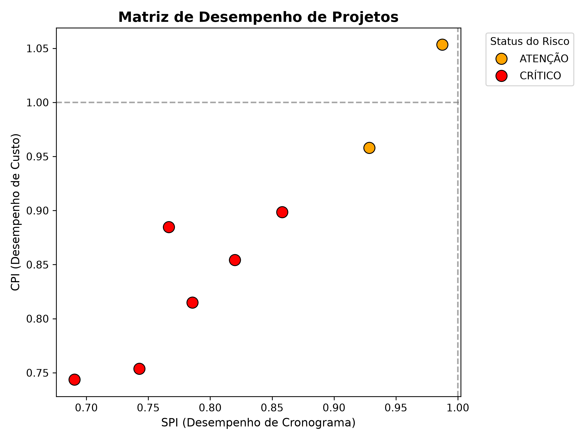
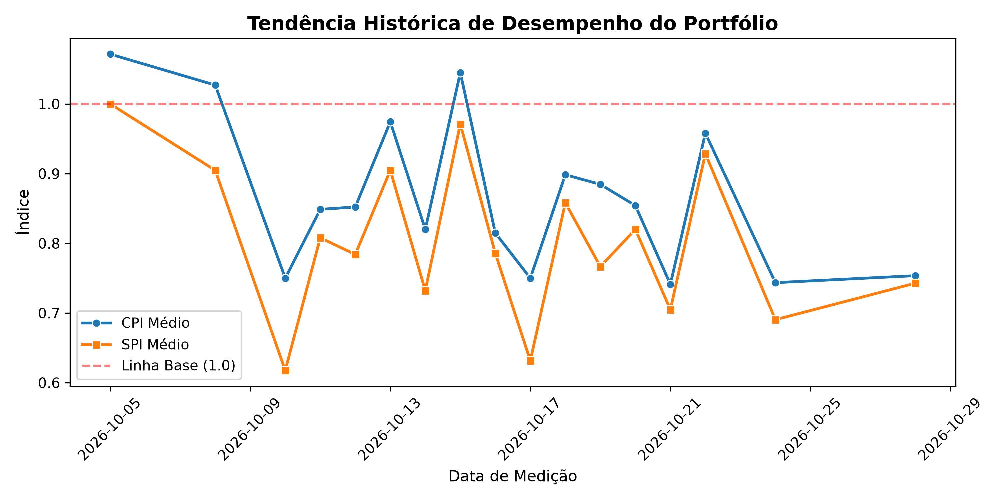

# Project EVM Monitor and Field Auditor

## O Problema de Negocio

Em empresas multidisciplinares de engenharia e gestao de projetos, como oleo e gas, mineracao, energias renovaveis e industria pesada, um grande desafio operacional e o desalinhamento entre o planejado e o executado. 

No dia a dia de campo, engenheiros e fiscais preenchem relatorios semanais sob pressao, gerando dados caoticos e inconsistentes. Isso inclui a mistura de pontuacoes, virgulas, cifras e formatos de datas divergentes. 

A utilizacao de planilhas espalhadas dificulta a consolidacao rapida de indicadores vitais. A demora na identificacao de estouros de orcamento ou desvios de cronograma gera prejuizos financeiros severos e riscos contratuais para a organizacao.

## A Solucao Tecnica e Arquitetura

O sistema foi desenvolvido utilizando uma arquitetura modular em Python buscando manter separacao de responsabilidades, manutenibilidade e escalabilidade do codigo. O fluxo e dividido nas seguintes camadas dentro do diretorio `src/`:

- `src/cleaning.py`: Modulo de ingestao e tratamento de dados (`raw_field_data.csv`). Realiza a normalizacao de campos monetarios inconsistentes e conversao padronizada de datas.
- `src/metrics.py`: Modulo de regras de negocio do Earned Value Management (EVM). Executa o calculo do CPI (Cost Performance Index), SPI (Schedule Performance Index), classificacao automatizada de status de risco e ordenacao cronologica temporal.
- `src/optimization.py`: Modulo de otimizacao matematica que modela o problema da Mochila Fracionaria para alocacao otimizada de recursos.
- `src/plots.py`: Modulo de visualizacao responsavel por gerar matrizes de desempenho e graficos de tendencia historica.
- `src/ml.py`: Modulo preditivo que treina modelo de Machine Learning (Regressao Logistica) para calculo de risco futuro de ruptura.
- `src/storage.py`: Modulo de persistencia responsavel por exportar os DataFrames processados para relatorios CSV.
- `src/main.py`: Modulo orquestrador que executa o pipeline completo de ponta a ponta.
- `src/predict.py`: Modulo orquestrador responsavel por executar o pipeline de Inteligencia Artificial Preditiva e exportar o relatorio estatistico.


## Formulacao Matematica

O sistema utiliza formulacoes matematicas divididas entre a camada de diagnostico de desempenho (EVM) e a camada de prescricao de decisoes (Otimizacao de Recursos).

### Indicadores de Desempenho (Earned Value Management)

Para cada medicao $t$ de um projeto $i$, os indices de desempenho de custo e prazo sao calculados por:

- **Indice de Desempenho de Custo (CPI):**
  $$CPI_i = \frac{EV_i}{AC_i}$$

- **Indice de Desempenho de Cronograma (SPI):**
  $$SPI_i = \frac{EV_i}{PV_i}$$

Onde:
- $PV_i$: Valor Planejado.
- $EV_i$: Valor Agregado.
- $AC_i$: Custo Real.


### Modelo de Otimizacao de Alocacao de Recursos

A alocacao de orcamento adicional e modelada como um problema de Programacao Linear (Mochila Fracionaria / Fractional Knapsack), considerando apenas a medicao mais recente de cada projeto que apresente desvio ($CPI_i < 1.0$ ou $SPI_i < 1.0$).

#### Parametros e Variaveis:
- $I$: Conjunto de projetos elegiveis com desvio no portfolio.
- $B_{total}$: Orcamento global limite para aporte financeiro ($B_{total} = 2.500.000,00$).
- $AC_i$: Custo real atual do projeto $i$.
- $M_i$: Demanda maxima de aporte do projeto $i$, definida como 30% do custo real:
  $$M_i = 0.30 \cdot AC_i$$
- $W_i$: Fator de urgencia (peso da funcao objetivo), inversamente proporcional a media dos indices de desempenho:
  $$W_i = \max\left(0.1, 2.0 - \frac{CPI_i + SPI_i}{2}\right)$$
- $x_i$: Variavel de decisao representando o montante financeiro alocado ao projeto $i$.

#### Formulacao do Modelo:

- **Funcao Objetivo:** Maximizar o retorno ponderado de prioridade sobre os projetos contemplados:
  $$\max \sum_{i \in I} W_i \cdot x_i$$

- **Restricao de Orcamento Global:**
  $$\sum_{i \in I} x_i \le B_{total}$$

- **Restricoes de Demanda e Nao-Negatividade:**
  $$0 \le x_i \le M_i, \quad \forall i \in I$$


## Camada Preditiva de IA (Machine Learning)

Além do cálculo determinístico de EVM, o sistema conta com um módulo preditivo (`src/ml.py`) baseado em **Regressão Logística (Classificação Binária)** via `scikit-learn`.

- **Objetivo:** Mapear a probabilidade estatística ($0.0\%$ a $100.0\%$) de um projeto entrar em estado **CRÍTICO** no ciclo subsequente.
- **Features Preditivas:** $CPI$ (Cost Performance Index) e $SPI$ (Schedule Performance Index).
- **Limiar de Decisão:** Projetos com probabilidade calculada $\ge 65.0\%$ disparam automaticamente o alerta `🔴 ALTA PROBABILIDADE DE RUPTURA`.


## Dashboards e Visualizacoes

O sistema gera automaticamente graficos na pasta `data/` para facilitar a tomada de decisao rapida:

### Matriz de Desempenho Atual (CPI vs SPI)


### Tendencia Historica do Portfolio



## Como Executar o Projeto

### Pré-requisitos
- Python 3.10+
- Ambiente virtual (`.venv`) configurado e ativo.

### Execução Local

1. Instale todas as dependências congeladas do projeto:
   ```bash
   pip install -r requirements.txt
   ```

2. Execute a suíte automatizada de testes unitários:
   ```bash
   python -m pytest
   ```

3. Pipeline de Auditoria EVM e Geração de Dashboards:
   ```bash
   python src/main.py
   ```

4. Pipeline de Inteligência Preditiva (Machine Learning):
   ```bash
   python src/predict.py
   ```


## Estrutura do Repositorio
```text
nr-evm-monitor/
│
├── .github/
│   └── workflows/
│       └── ci.yml
│
├── data/
│   ├── raw_field_data.csv
│   ├── processed_evm_report.csv
│   ├── ml_predictive_report.csv
│   ├── optimized_resource_allocation.csv
│   ├── cpi_spi_matrix.png
│   └── evm_trends.png
│
├── src/
│   ├── __init__.py
│   ├── cleaning.py
│   ├── metrics.py
│   ├── ml.py
│   ├── optimization.py
│   ├── plots.py
│   ├── predict.py
│   ├── storage.py
│   └── main.py
│
├── tests/
│   ├── test_metrics.py
│   ├── test_ml.py
│   └── test_optimization.py
│
├── Dockerfile
├── requirements.txt
└── README.md